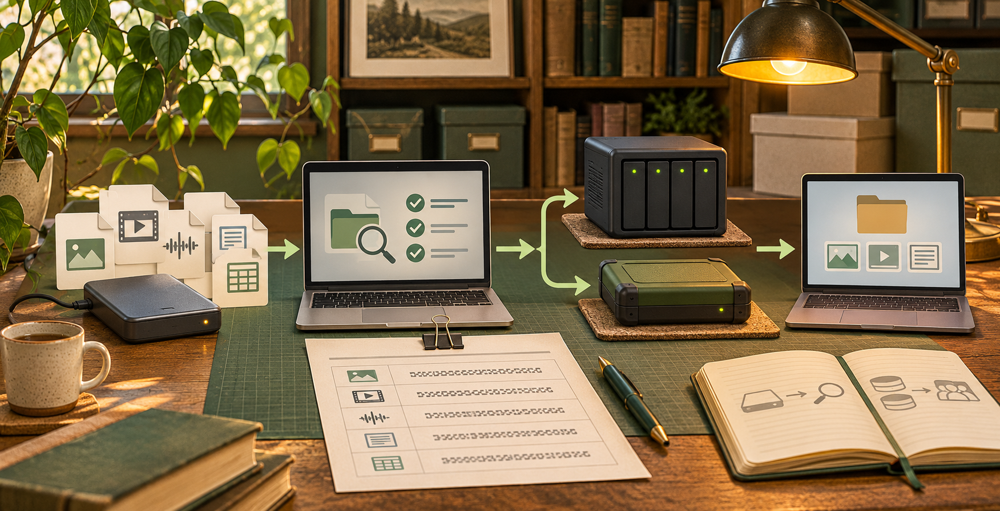

# Digital Preservation Skill for Claude Code



A professional-grade skill for [Claude Code](https://claude.ai/code) covering digital preservation — from first principles through to practical operations. Built for archivists, records managers, museum staff, and heritage professionals.

## Install with your AI agent

Copy and paste this into your agent:

```text
Install the Digital Preservation skill from https://github.com/matthewbrutonall/digital-preservation-skill using your agent's supported skill installation method. Use the packaged skill or keep the complete `digital-preservation` directory, including its reference files, together. Confirm the skill is available and tell me how to invoke it. Do not inspect my records yet.
```

## What It Covers

- **Frameworks and models** — DPC RAM, OAIS, NDSA Levels, DPM 3-Legged Stool
- **Bitstream preservation** — integrity checking, fixity, checksums, storage planning, 3-2-1 rule
- **File formats** — format risk, preferred formats by content type, migration vs emulation, born-digital vs digitised
- **Ingest workflows** — workstation setup, write blockers, virus checking, characterisation, DROID/Siegfried
- **Metadata** — PREMIS, METS, BagIt, verifiable file manifests, Digital Asset Registers
- **Select and transfer** — depositor guidance, appraisal, selection
- **Storage** — hard disk, tape, cloud, refresh cycles, disaster planning
- **Access** — user needs, accessibility, IPR, sensitive data, access copies, access workstations
- **Web archiving** — WARC, crawl tools, replay, workflow
- **Records management** — retention schedules, disposal, legal holds, appraisal, vital records
- **Tools reference** — characterisation, integrity, copying, disk imaging, validation, email preservation
- **Glossary** — key terms defined

Includes jurisdiction notes for UK, Ireland, USA, Australia, and EU.

## Install

```bash
claude skills install https://github.com/matthewbrutonall/digital-preservation-skill
```

Or download [`digital-preservation.skill`](digital-preservation.skill) and install locally:

```bash
claude skills install digital-preservation.skill
```

## Usage

Once installed, Claude will automatically apply this skill when you ask about digital preservation topics. For example:

- *"How do I set up an ingest workstation?"*
- *"What checksum algorithm should I use?"*
- *"What formats should I use for scanned images?"*
- *"How do I write a retention schedule?"*
- *"What is OAIS?"*
- *"How do I start a web archiving programme?"*

## Skill Structure

```
digital-preservation/
├── SKILL.md                        # Core frameworks and topic index
├── cheatsheet.md                   # One-page quick reference
└── references/
    ├── workflows.md                # Four-workflow steps (Select & Transfer, Ingest, Preserve, Access)
    ├── file-formats.md             # Format risk, preferred formats, migration, emulation
    ├── access.md                   # Access provision in depth
    ├── web-archiving.md            # Web archiving: WARC, tools, workflow
    ├── records-management.md       # Retention, disposal, legal holds, appraisal
    ├── tools.md                    # Tools reference by function
    └── glossary.md                 # Key term definitions
```

## Audience

Designed for anyone responsible for digital preservation who is not necessarily a technical specialist — archivists, records managers, museum curators, local studies librarians, heritage staff. Covers both the "why" and the "how", with practical checklists and decision frameworks throughout.

## Standards Covered

OAIS (ISO 14721), PREMIS, METS, BagIt, DPC RAM v2.0, NDSA Levels of Digital Preservation, DLF Levels of Born-Digital Access, ISO 15489 (Records Management), WARC (ISO 28500), PRONOM, and more.

## Reviews

Independent reviews from other archivists, practitioners, and AI researchers are very welcome — please open an issue or pull request.

## Licence

[MIT](LICENSE)

## Author

[Matthew Bruton](https://github.com/matthewbrutonall) — contract archivist and digital preservation practitioner.
